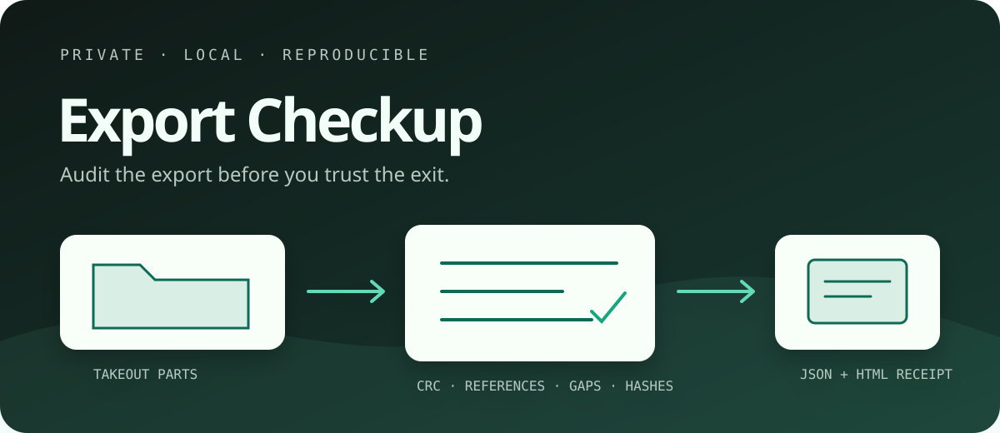

<p align="center">
  
</p>

# Export Checkup

**在删除账号或替换旧备份前，审计 Google Takeout 与 Instagram 导出包。** 这是一个零上传 Rust CLI：直接读取目录和多分卷 ZIP，校验可读取的每个字节、解析平台引用、比较两次导出，并生成确定性的 JSON 与完全离线 HTML 凭据。

[English](README.md) · [调研记录](docs/research.md) · [支持格式](docs/supported-formats.md) · [故障修复](docs/troubleshooting.md)

## 它真正能证明什么

Export Checkup 能证明你提供的文件之间是否自洽：

- ZIP 条目能否解压并通过 CRC 读取校验；
- 是否有路径穿越、跨分卷同名冲突或仅大小写不同的覆盖风险；
- 常见图片/视频的文件签名是否与扩展名一致；
- Google Photos 侧车 JSON 是否能找到媒体，媒体是否缺侧车；
- Instagram `message_N.json` 是否连续，本地附件 URI 是否存在；
- 新导出是否丢失了旧导出里已有的规范化路径；
- 是否为每个可读文件生成稳定 SHA-256。

它**不能**证明平台是否遗漏了一个从未写进导出清单的云端记录。报告全绿只表示“在当前检查范围内内部一致”，不等于“无需人工确认即可删除账号”。CLI 帮助和 HTML 报告都固定展示这个边界。

## 快速使用

从 [Releases](https://github.com/KanadeK/export-checkup/releases/latest) 下载对应平台的二进制。一次扫描必须同时传入同一批导出的全部分卷：

```powershell
export-checkup scan takeout-001.zip takeout-002.zip `
  --json export-receipt.json `
  --html export-receipt.html `
  --strict
```

比较两次完整导出：

```powershell
export-checkup compare `
  --before old-001.zip --before old-002.zip `
  --after new-001.zip --after new-002.zip `
  --json comparison.json `
  --html comparison.html
```

查询任意发现项的修复步骤：

```powershell
export-checkup explain instagram.missing_attachment
export-checkup explain --list
```

运行时不会解压 ZIP、不会跟随符号链接、不会上传数据，也不会修改输入文件。

## 真实功能

| 层级 | 实际执行内容 |
| --- | --- |
| 输入 | 安全递归目录；流式解压与 CRC 校验；拒绝路径穿越 |
| 分卷 | 检测完全重复、同路径不同内容、仅大小写不同的文件 |
| 内容 | 流式 SHA-256；有限内存 JSON 解析；媒体签名与闭合标记检查 |
| Google Photos | 解析侧车 JSON；按 `title`/文件名跨分卷配对；发现缺媒体、缺侧车和歧义配对 |
| Instagram | 解析消息分页；逐会话检查页码缺口；递归解析本地 `uri`；发现缺附件 |
| 比较 | 去除导出外层目录差异；报告丢失、新增和同路径内容变化 |
| 凭据 | 带版本的确定性 JSON；转义安全、单文件离线 HTML；完整文件清单 |

## 退出码

| 代码 | 含义 |
| ---: | --- |
| `0` | 没有错误；未使用 `--strict` 时允许警告 |
| `1` | 命令参数或报告写入失败 |
| `2` | `--strict` 模式下存在警告 |
| `3` | 发现完整性错误或比较回归 |

## 验收

仓库内的样例全部为虚构数据：

```powershell
cargo run -- scan examples/healthy --strict

# 预期退出 3，并给出每项修复流程
cargo run -- scan examples/broken

# 预期退出 3，因为新导出丢失了 lost.txt
cargo run -- compare --before examples/compare-before --after examples/compare-after
```

完整发布前检查：

```powershell
powershell -ExecutionPolicy Bypass -File scripts/verify.ps1
```

若失败，先保留原始导出，运行 `export-checkup explain <发现代码>`，补齐分卷或重新申请导出，再重跑 `scan`，最后用 `compare` 与旧批次核对。不要通过删除触发问题的证据来“修绿”报告。

## 隐私、安全与范围

- 全程离线，无遥测；报告里的文件名和哈希仍应当视作私人数据。
- 输出已存在时必须显式传 `--force`，并通过同目录临时文件替换。
- v0.1 支持通用 ZIP/目录、Google Photos 侧车和 Instagram JSON 消息导出。
- 项目与 Google、Meta 无隶属或背书关系。

更多架构、限制、适配器扩展方式和逐项修复见 `docs/`。项目使用 [MIT](LICENSE) 许可证。
