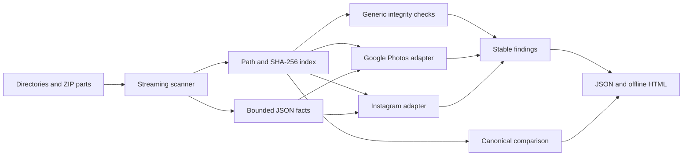

# Architecture

Export Checkup is a library-first Rust application. The binary only parses arguments, writes requested outputs, prints a summary, and maps findings to exit codes.

## Modules

- `scanner.rs` owns safe traversal, ZIP reads, hashing, media signatures, multipart conflicts, and the bounded JSON handoff.
- `pathing.rs` owns slash normalization, traversal rejection, media classification, and provider-wrapper-independent canonical paths.
- `adapters/` extracts provider facts and resolves relationships only through the shared read-only index.
- `compare.rs` compares canonical path/hash manifests from two independent scans.
- `model.rs` is the serializable report contract.
- `report.rs` performs deterministic serialization, HTML escaping, and same-directory atomic output writes.
- `remediation.rs` is the single source of truth for stable finding codes and repair procedures.
- `cli.rs` maps commands to library functions and documented exit codes.

## Data flow and memory

Every file is read once. A 64 KiB buffer feeds SHA-256, a 64-byte prefix, and a 64-byte rolling suffix. Media is never retained in memory. JSON is retained only until provider facts are extracted and only when the file is at or below `--max-json-mib` (32 MiB by default).

The final in-memory file manifest is proportional to file count, not total media bytes. Reports deliberately include hashes and logical paths because they are evidence; users should keep reports private.

## Trust boundaries

- Input roots and archive entry names are untrusted.
- Provider JSON values are untrusted strings and are normalized before resolution.
- Archive entries are never written to disk.
- Reports do not embed file bodies, JSON message content, or sidecar descriptions.
- The comparison layer never merges bytes; it compares independently computed manifests.

## Determinism

Inputs, file records, findings, provider metrics, and comparison paths are sorted. Reports contain no wall-clock timestamp, hostname, absolute source path, random identifier, or network-derived metadata. Two scans of unchanged inputs with the same version produce byte-identical JSON and HTML.
